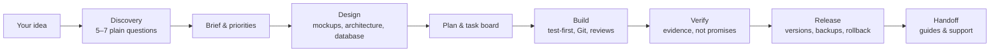

# Hire an Engineer

**An AI senior software engineer for non-technical builders and vibe coders.**
Turn your AI coding tool into the engineer you would otherwise have to hire — it plans, structures, designs, builds, tests, ships and documents your software while you focus on the idea.

Works with **Claude Code · claude.ai · Cursor · Codex · Antigravity** and any agent that supports Agent Skills or `AGENTS.md`.

---

## What is Hire an Engineer?

**Hire an Engineer** is an open-source **agent skill** that makes your AI assistant behave like a **senior software engineer you hired** — one who can also act as your whole software team: product manager, UI/UX designer, architect, project manager, developer, database admin, QA tester, DevOps and technical writer.

It's built for people who **can use AI coding tools but don't have a software engineering background**: founders, creators, designers, marketers, students and domain experts who have an idea, start **vibe coding**, and then hit the same walls:

| Without an engineer | With Hire an Engineer |
|---|---|
| You get **stuck** in error loops and don't know what to try next | An **unstuck protocol**: stop guessing, find the root cause, roll back safely, take one small step |
| The project becomes a **mess** — giant files, duplicate code, random folders | A **standard project structure** and a structure guard from day one |
| Every new chat or tool **forgets everything** | **Persistent project memory** in your repo (`AGENTS.md`, `PROJECT_STATE.md`), saved every ~20 minutes |
| **No documentation**, no plan, no idea what's done | **Docs-as-code**: brief, design, diagrams, plan, test reports, user guide — always current |
| You don't know which **APIs, tools or databases** you need | It finds them, compares options, sets them up safely, and keeps your keys out of chat |
| "It works on my machine" → broken launches | **Test-first build**, verified releases with version numbers, backups and rollback |
| Surprise **AI and hosting bills** | **Cost and token tracking**, budgets and alerts |

You don't need to learn engineering. You talk in plain language (English, Urdu, Roman Urdu or any language you use); it does the engineering.

## Who is it for?

- **Non-technical founders** building an MVP with AI
- **Vibe coders** using Claude Code, Cursor, Codex or Antigravity who keep getting stuck
- **No-code / low-code users** ready to go beyond templates
- **Small business owners** who want an internal tool, dashboard or **process automation**
- **Designers, marketers, creators and students** turning ideas into working apps
- **Anyone rescuing a messy AI-generated project**

Not designed for experienced developers asking routine coding questions.

## What it can build

Scripts and automations · spreadsheet systems · websites and landing pages · internal team tools · web and mobile apps · dashboards and reports · chatbots and AI tools · integrations and bots · game prototypes, **three.js game engines** and editors · developer tools and SDKs · **Slack-style real-time platforms** · fixing and finishing existing projects.

It sizes the process to the job: a tiny script gets a quick, tested result; a large platform gets a roadmap, task board, staging, releases and monitoring.

## How it works

- **Plain language, no lectures.** It asks about your world ("Should each user only see their own orders?"), not jargon ("Do you need RBAC?").
- **You decide the product, it decides the engineering** — and asks your approval before anything that costs money, creates accounts, sends, publishes or deletes.
- **Evidence before "done."** It runs the checks before telling you something works.
- **Fast lane** when you just want a prototype now; full process when others will rely on it.
- **Memory lives in your project**, so you can switch between Claude, Cursor, Codex and Antigravity without losing context.

## Quick start

1. Download `hire-an-engineer.skill` (or `.zip`) from [Releases](../../releases).
2. Install it:
   - **claude.ai:** open the `.skill` file in a chat → **Save skill** (or upload in Settings).
   - **Claude Code:** `cp -r skills/hire-an-engineer ~/.claude/skills/`
   - **Cursor / Codex / Antigravity / others:** copy the folder into the tool's skills directory, or point your `AGENTS.md` / rules file at `skills/hire-an-engineer/SKILL.md`.
3. Say what you want: *"I want to build a booking app for my salon"* — or *"I'm stuck, my app broke after the last change."*

Full instructions: [docs/INSTALL.md](docs/INSTALL.md)

## Example

> **You:** I run a home bakery. Orders come from WhatsApp, Instagram and calls, and I forget some. Can you build something?
>
> **Hire an Engineer:** asks a few questions about your day → finds the real problem (orders scattered across three places) → proposes a simple order form + order list + WhatsApp alert → shows a clickable mockup on your phone → sets up the repo, database and task board with your approval → builds and tests it milestone by milestone ("12 of 12 checks passed") → releases v1.0 with backups → hands you a user guide and keeps project memory so the next session continues where you stopped.

## What's inside

| Area | Highlights |
|---|---|
| Product & planning | Root-cause discovery, MVP scoping, roadmap, prioritised task board (P0–P3), status updates |
| UI/UX | Wireframes, clickable mockups, every screen state, UX copy, accessibility (WCAG), usability tests |
| Architecture | Simplest-approach ladder, system design, diagrams (Mermaid), decision records |
| Data | Database design, data dictionary, migrations, access rules, tested backups |
| Integrations | Discovering required APIs, choosing providers, safe API-key handling, webhooks, fallbacks |
| Automation | Process mapping, human-in-the-loop, dry runs, real-case testing, runbooks |
| Engineering | Test-driven development, systematic debugging, code review, testing pyramid, OWASP, Definition of Done |
| Delivery | GitHub workflow, CI, semantic versioning, changelogs, release checklist, rollback |
| Memory & docs | `AGENTS.md`, `PROJECT_STATE.md`, ~20-minute checkpoints, docs-as-code, chat → coding-agent handoff |
| Cost | Token-efficient work, AI cost design, usage audit, budgets and alerts |
| Complex products | Game engines, editors, SDKs, multi-tenant real-time platforms, playable-ad export |

## FAQ

**Is this a replacement for a human developer?**
It covers what a senior engineer would do inside your AI tool. For payments at scale, health or children's data, legal compliance or security of large public systems, it will recommend a qualified human review.

**Do I need to know how to code?**
No. You need to be comfortable using an AI tool. It runs the engineering and explains things only in plain terms.

**Which AI tools does it work with?**
Claude (claude.ai and Claude Code), Cursor, Codex, Antigravity and other agents that support Agent Skills or read `AGENTS.md`. Chat-only tools handle planning, design, docs and prototypes; coding agents handle the full build.

**How is it different from Superpowers?**
[Superpowers](https://github.com/obra/superpowers) gives developers a disciplined workflow. Hire an Engineer adapts that discipline for people *without* an engineering background and adds the rest of the team: product, UI/UX, project management, databases, integrations, releases, documentation, memory and cost tracking.

**Is it free?**
Yes — MIT licensed.

## Feedback

Found a gap? [Open an issue](../../issues/new/choose) — the skill can even draft one for you (you review it first). Please never include private code, keys or personal data.

This repository is maintained by its owner: **issues welcome, pull requests not accepted.** Forks are welcome under the MIT License. See [CONTRIBUTING.md](CONTRIBUTING.md).

## License & credits

[MIT](LICENSE). Engineering discipline adapted from [Superpowers](https://github.com/obra/superpowers) by Jesse Vincent (MIT). Other attributions in [THIRD_PARTY_NOTICES.md](THIRD_PARTY_NOTICES.md).
