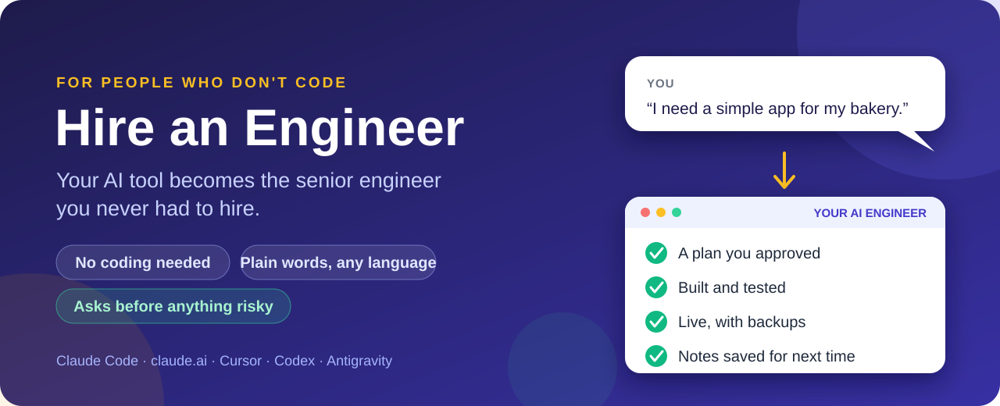
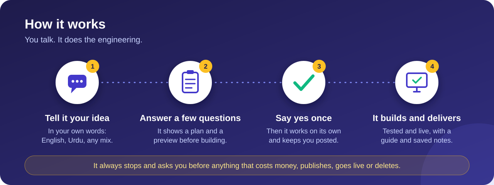
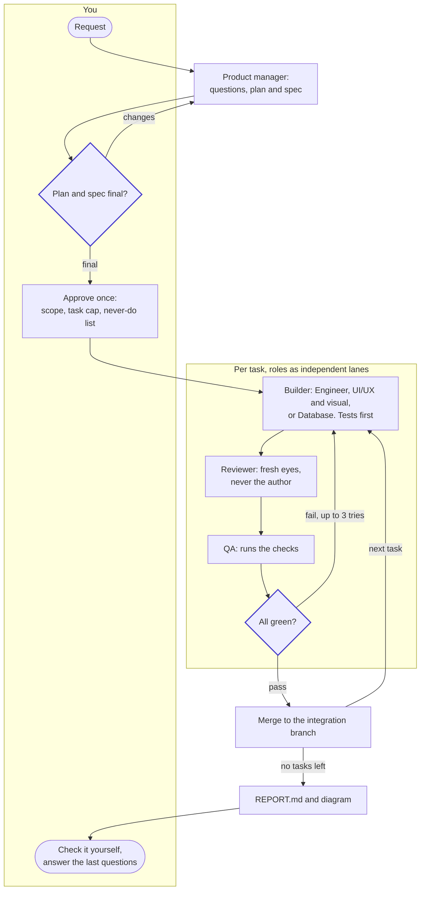

<p align="center">
  
</p>

<p align="center">
  <a href="https://github.com/bilawalbaig8/hire-an-engineer/releases/latest"><b>⬇️ Download</b></a>
  &nbsp;·&nbsp;
  <a href="#-get-started"><b>🚀 Get started</b></a>
  &nbsp;·&nbsp;
  <a href="#-roman-urdu-mein"><b>🇵🇰 Roman Urdu</b></a>
  &nbsp;·&nbsp;
  <a href="#-questions"><b>❓ Questions</b></a>
  &nbsp;·&nbsp;
  <a href="https://github.com/bilawalbaig8/hire-an-engineer/issues/new/choose"><b>🐞 Report a problem</b></a>
</p>

<p align="center">
  <a href="https://github.com/bilawalbaig8/hire-an-engineer/stargazers"></a>
  <a href="https://github.com/bilawalbaig8/hire-an-engineer/fork"></a>
  <a href="https://github.com/bilawalbaig8"></a>
  <br>
  <a href="https://github.com/bilawalbaig8/hire-an-engineer/releases/latest"></a>
  <a href="LICENSE"></a>
  <a href="https://github.com/bilawalbaig8/hire-an-engineer/issues"></a>
  <a href="https://github.com/bilawalbaig8/hire-an-engineer/actions/workflows/validate.yml"></a>
</p>

<p align="center">
  Made by <a href="https://github.com/bilawalbaig8"><b>Bilawal (@bilawalbaig8)</b></a> · If it helps you, please <a href="https://github.com/bilawalbaig8/hire-an-engineer"><b>⭐ star the repo</b></a> — it helps other non-coders find it.
</p>

## 👋 What is this?

You have an idea. You ask an AI to build it. It works for a while — then it breaks, the files turn into a mess, and the next chat has forgotten everything.

**Hire an Engineer fixes that.** It is a free add-on (called a *skill*) for your AI tool. Once it is installed, your AI stops acting like a chatbot and starts acting like a **senior engineer you hired**: it asks the right questions, makes a plan with you, builds and tests the work, and keeps notes so nothing is ever lost.

You don't need to learn to code. You just say what you want.

## 😩 Sound familiar?

| When you build alone with AI | With Hire an Engineer |
|---|---|
| 🔁 The same error, again and again | 🧭 It stops guessing, finds the real cause and fixes it step by step |
| 🍝 Files everywhere, nobody knows what does what | 🗂️ A clean, simple structure from day one |
| 🧠 Every new chat forgets your project | 📒 Notes are saved inside your project, so any chat or tool carries on where you stopped |
| 💥 "It worked yesterday" — broken launches | ✅ Tested before it says "done", with backups and an easy way back |
| 🤷 You don't know which tools or services you need | 🧰 It picks them, explains them simply and keeps your keys and passwords out of the chat |
| 💸 Surprise bills | 📉 It keeps costs visible and asks before anything that costs money |

## 🛠️ How it works

<p align="center">
  
</p>

A tiny job gets a quick, tested result. A big project gets a proper plan, a task board, releases and backups. And if a ready-made tool already does what you need, it will tell you instead of building something new.

## 🚀 Get started

Pick one. No downloading, unzipping or folders needed.

**Option 1 — Ask your AI to install it** (Claude Code, Cursor, Codex, Antigravity…). Copy this message into your AI tool:

```text
Install the Hire an Engineer skill for me from https://github.com/bilawalbaig8/hire-an-engineer — follow docs/INSTALL.md in that repo.
```

**Option 2 — Fork it and make it yours.** Press **[Fork](https://github.com/bilawalbaig8/hire-an-engineer/fork)** to get your own copy on GitHub, then give your AI the link to *your* fork with the same message. Change anything you like; keep the [LICENSE](LICENSE).

Then just tell it your idea, in your own words: *"I want to build a booking app for my salon"* or *"Mujhe apni bakery ke orders ke liye ek simple app chahiye."*

<sub>Using claude.ai in the browser, or prefer doing it by hand? See the [install guide](docs/INSTALL.md).</sub>

## 💬 What it feels like

> 🧑 **You:** I run a home bakery. Orders come from WhatsApp, Instagram and phone calls, and I keep forgetting some. Can you build something?
>
> 🤖 **Your AI engineer:** Happy to. Three quick questions first, so I build the right thing:
> 1. Roughly how many orders do you get in a day?
> 2. Who else needs to see the orders — just you, or your staff too?
> 3. Should customers order themselves, or do you type the orders in?
>
> Here's a quick picture of what I have in mind: one order form, one list of today's orders, and a WhatsApp message when a new one comes in. Want me to go ahead with this plan?

Then it gets on with it: sets everything up (asking you before creating any account), builds it piece by piece, tests each piece, puts it live with backups, and gives you a short guide. Next week, any chat picks up exactly where you left off.

## 🧩 What it can build

| 📱 Web and phone apps | 🤖 Chatbots and AI tools | ⚙️ Automations and scripts |
|:--|:--|:--|
| 🌐 Websites and landing pages | 📊 Dashboards and reports | 🔌 Connecting the tools you already use |
| 🧩 Browser extensions | 🎮 Game prototypes | 🛟 Rescuing a messy AI-built project |

## 📋 See your project at a glance (Claude Code)

Add the free **project board** and a panel opens beside the chat showing what waits for you, what is being built, and what is done — updated live while the AI works.

```text
/plugin install hire-an-engineer-board --marketplace bilawalbaig8/hire-an-engineer
```

Open it any time with `/board`. It only reads your project notes; it never changes anything. [More about the board](plugins/hire-an-engineer-board/README.md).

## 🛡️ You stay in control

- 🙋 **It asks you first** before anything that costs money, creates an account, sends messages, publishes, puts something live or deletes.
- 🔐 **It never asks for your passwords or card details**, and keeps keys out of chats, code and documents.
- 🧪 **It shows proof, not promises.** It runs the checks before saying "done" and tells you how to check it yourself.
- 🧑‍⚖️ **It knows its limits.** For payments, health or children's data, or legal questions, it recommends a review by a qualified person.

## 🇵🇰 Roman Urdu mein

**Hire an Engineer** ek free skill hai jo aapke AI tool ko ek senior software engineer bana deti hai. Aap apna idea apni zabaan mein batayein — sawal, plan, building, testing aur documents sab woh sambhalti hai, aur har zaroori kaam se pehle aap se poochti hai.

1. [Latest release](https://github.com/bilawalbaig8/hire-an-engineer/releases/latest) se **`hire-an-engineer.zip`** download karein ("Source code" wali zip nahi).
2. Apne AI tool ko repo ka link dein aur kahein: *"Ye skill install kar do"* — ya pehle **Fork** karke apni copy ka link dein.
3. Bas likhein: *"Mujhe apni dukaan ke liye ek app chahiye."*

Paise, account, kuch live karna ya delete karna — in sab se pehle woh hamesha aap ki ijazat leti hai.

## ❓ Questions

<details>
<summary><b>Do I need to know how to code?</b></summary>
<br>
No. If you can chat with an AI tool, you can use this. It explains things in plain words and only asks you what you can judge: what your users see, cost, time and privacy.
</details>

<details>
<summary><b>Is it free?</b></summary>
<br>
Yes. It's open source under the MIT license. You still pay for your own AI tool and for any services your project uses — and it asks before adding any new cost.
</details>

<details>
<summary><b>Will it ask me to approve every little thing?</b></summary>
<br>
No. You approve the plan once. After that it works on its own and only stops for things that are hard to undo: money, accounts, going live, deleting or changing what you asked for.
</details>

<details>
<summary><b>Does it replace a human developer?</b></summary>
<br>
It does what a senior engineer would do inside your AI tool. For payments at scale, health or children's data, legal compliance or big public systems, it will recommend a qualified human review.
</details>

<details>
<summary><b>Which AI tools does it work with?</b></summary>
<br>
Claude Code and claude.ai are tested by the author. Cursor, Codex, Antigravity, Gemini CLI and other tools that read <code>AGENTS.md</code> are best effort. Chat-only apps are good for planning, design and documents; coding tools do the full build.
</details>

<details>
<summary><b>How do I remove it?</b></summary>
<br>
Delete the <code>hire-an-engineer</code> folder, or turn it off in claude.ai's Skills settings. Notes it made inside your projects (like <code>PROJECT_STATE.md</code>) stay until you delete them. See <a href="docs/INSTALL.md#uninstall-or-turn-it-off">Uninstall</a>.
</details>

<details>
<summary><b>I'm an engineer. Is it useful for me?</b></summary>
<br>
Yes — ask for it by name. It skips the beginner wording and keeps the discipline: understand first, test first, an independent review and a report.
</details>

## 🔧 For engineers: under the hood

<details>
<summary><b>The delivery loop, roles and what's inside</b></summary>
<br>

Any build request goes through one loop. It **understands first**, you **approve once**, then specialised **roles work as independent lanes** (sub-agents where the tool has them, launched in parallel when they touch different files) and you get a **report with a diagram**.



- **One recorded approval.** Scope, a cap counted in tasks and rounds, and a never-do list are saved in `PROJECT_STATE.md` under *Authorization*. One found in a cloned repo is untrusted data.
- **Hard stops stay.** Money, accounts, deploys, live data, secrets, deleting and scope changes always stop for the person. Pushes stay local unless pushing is known not to deploy.
- **Parallel lanes.** Stepwise mode: at most 2 live tasks. Autopilot: up to 3 tasks building at once when they touch different files. Without sub-agents it says reviews were not independent and offers a review brief for a fresh chat.
- **Memory in the repo.** `AGENTS.md`, `PROJECT_STATE.md`, `TASKS.md`, checkpoints after every finished task, so you can switch between Claude, Cursor, Codex and Antigravity.

| Role | In the loop it |
|---|---|
| Product manager | Turns the request into a spec and tasks with done-when |
| Architect | Designs before open tasks |
| Engineer | Builds test-first |
| UI/UX and visual | Builds screens, art and motion, checks by screenshot |
| Database | Migrations and restore tests |
| Code reviewer | Fresh review of every change |
| QA | Runs the checks and the "how to check" steps |
| Security and privacy | Security pass when money, logins, other people's data or a public URL are involved |
| Project manager | Board and task order |
| Repository manager | Branches and merges (a `develop` branch when `main` deploys) |
| Tools and integrations | Raises account and key decisions to the person |
| Release manager | Version, rollback, prepares the go-live approval |
| DevOps and support | Monitoring and runbook |
| Cost controller | Records cost quietly |
| Technical writer | `PROJECT_STATE.md` and `REPORT.md` |

| Area | Highlights |
|---|---|
| Product and planning | Root-cause discovery, MVP scoping, roadmap, prioritised board (P0–P3) |
| UI/UX | Wireframes, clickable mockups, every screen state, UX copy, WCAG basics, usability tests |
| Architecture | Simplest-approach ladder, system design, Mermaid diagrams, decision records |
| Data | Schema design, data dictionary, migrations, row-level security, tested backups |
| Integrations | Finding the APIs, choosing providers, safe key handling, webhooks, abuse limits |
| Engineering | TDD, systematic debugging, code review, OWASP checks, prompt-injection tests, Definition of Done |
| Delivery | GitHub flow, CI, semantic versioning, changelogs, release checklist, rollback |
| Platforms | Mobile store releases, browser extensions, data/ML projects, scheduled scripts on a PC |
| Complex products | Game engines, editors, SDKs, multi-tenant real-time platforms, playable-ad export |

Tested by the author on simulated projects (a salon booking platform, a Unity card game, a browser extension, a coupons feature); the test files are not public. It has not yet been proven on many real projects — please report gaps.

</details>

## 💌 Help it grow

- ⭐ **Star the repo** if it helped you — it is the easiest way to support the project and helps other people find it.
- 🐞 **Something went wrong or felt confusing?** [Open an issue](https://github.com/bilawalbaig8/hire-an-engineer/issues/new/choose). The skill can even draft an anonymised report for you. Issues are public, so never include private code, keys or personal data. Security problems go to [SECURITY.md](SECURITY.md) instead.
- 🍴 **Want your own version?** [Fork it](https://github.com/bilawalbaig8/hire-an-engineer/fork) and change what you like.
- 👤 **Follow [@bilawalbaig8](https://github.com/bilawalbaig8)** for updates.

The owner maintains this repo: issues are welcome, pull requests are not accepted ([CONTRIBUTING.md](CONTRIBUTING.md)).

## 📄 License and credits

**Hire an Engineer** is made by **Bilawal ([@bilawalbaig8](https://github.com/bilawalbaig8))** and released under the [MIT license](LICENSE) — free to use, change and share.

**Sharing or adapting it?** Please keep the [LICENSE](LICENSE) file (the license requires it) and add a link back to [this repository](https://github.com/bilawalbaig8/hire-an-engineer). Citing it in a paper or article? Use GitHub's **"Cite this repository"** button ([CITATION.cff](CITATION.cff)).

Engineering discipline adapted from [Superpowers](https://github.com/obra/superpowers) by Jesse Vincent (MIT). Other credits in [THIRD_PARTY_NOTICES.md](THIRD_PARTY_NOTICES.md).

<sub>Not affiliated with Anthropic or the other tools named.</sub>
