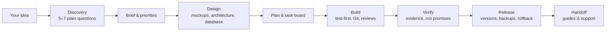
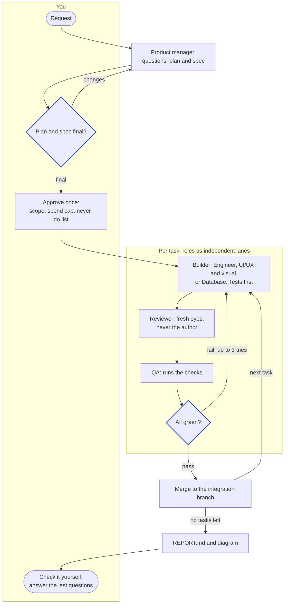

# Hire an Engineer

**An AI senior software engineer for non-technical builders and vibe coders.**
Turn your AI coding tool into the engineer you would otherwise have to hire — it plans, structures, designs, builds, tests, ships and documents your software while you focus on the idea.

Works with **Claude Code · claude.ai · Cursor · Codex · Antigravity** and any agent that supports Agent Skills or `AGENTS.md`. Tested by the author on Claude Code and claude.ai; the others are best effort.

---

## Start in 2 minutes

**What it is:** a free add-on (called a *skill*) for your AI tool. Once it is installed, the AI works like a senior software engineer you hired: it asks a few plain questions, makes a plan, builds your software, tests it, and keeps notes so the next chat remembers everything.

**Who it's for:** people who use AI tools to build things but have no software background: founders, shop owners, designers, marketers, students. You do not need a terminal or any coding knowledge.

**3 steps**
1. **Download** `hire-an-engineer.zip` from the [latest release](https://github.com/bilawalbaig8/hire-an-engineer/releases/latest) (look under **Assets**). Do **not** use "Source code (zip)" or the green **Code → Download ZIP** button; they have the wrong layout.
2. **Install** it:
   - **claude.ai:** upload the zip **as it is, do not unzip it**, in Settings → Capabilities (or Skills). Menu names can change. Code execution must be turned on.
   - **Claude Code:** unzip it and put the `hire-an-engineer` folder inside your `.claude/skills` folder. No terminal needed; click-by-click steps for Windows and Mac are in [docs/INSTALL.md](docs/INSTALL.md).
   - **Cursor, Codex, Antigravity, others:** see [docs/INSTALL.md](docs/INSTALL.md).
3. **Say what you want.** Your first message can be as simple as:
   - English: *"I want to build a booking app for my salon."*
   - Roman Urdu: *"Mujhe apni bakery ke orders ke liye ek simple app chahiye."*

**Check it worked:** ask *"what skills do you have?"* and look for `hire-an-engineer`.

**Roman Urdu mein khulasa:** Hire an Engineer ek free skill hai jo aapke AI tool ko senior software engineer bana deti hai. Aap apna idea aasan zabaan mein batayein; planning, building, testing aur documents woh sambhalti hai. Install karne ke liye Releases se `hire-an-engineer.zip` download karein: claude.ai mein zip ko unzip kiye baghair upload karein, Claude Code mein unzip karke folder `.claude/skills` mein rakhein (poori tarkeeb [docs/INSTALL.md](docs/INSTALL.md) mein hai). Pehla message likhein, jaise: *"Mujhe apni bakery ke orders ke liye ek simple app chahiye."*

**Remove it later:** delete the `hire-an-engineer` folder (or switch it off in claude.ai's Skills settings). Files it made in your projects, such as `PROJECT_STATE.md`, stay until you delete them. Details in [docs/INSTALL.md](docs/INSTALL.md#uninstall-or-turn-it-off).

---

## What is Hire an Engineer?

**Hire an Engineer** is an open-source **agent skill** that makes your AI assistant behave like a **senior software engineer you hired** — one who can also act as your whole software team: product manager, UI/UX designer, architect, project manager, developer, database admin, QA tester, DevOps and technical writer.

It's built for people who **can use AI coding tools but don't have a software engineering background**: founders, creators, designers, marketers, students and domain experts who have an idea, start **vibe coding** (building by chatting with an AI), and then hit the same walls:

| Without an engineer | With Hire an Engineer |
|---|---|
| You get **stuck** in error loops and don't know what to try next | An **unstuck protocol**: stop guessing, find the root cause, roll back safely, take one small step |
| The project becomes a **mess** — giant files, duplicate code, random folders | A **standard project structure** and a structure guard from day one |
| Every new chat or tool **forgets everything** | **Persistent project memory** in your repo (`AGENTS.md`, `PROJECT_STATE.md`), saved at every finished task (about every 20 minutes) |
| **No documentation**, no plan, no idea what's done | **Docs-as-code**: brief, design, diagrams, plan, test reports, user guide — always current |
| You don't know which **APIs, tools or databases** you need | It finds them, compares options, sets them up safely, and keeps your keys out of chat |
| "It works on my machine" → broken launches | **Test-first build**, verified releases with version numbers, backups and rollback (going back to the last working version) |
| Surprise **AI and hosting bills** | It **tracks the running and AI costs of your product** and sets budget alerts with your approval (its own build usage is shown as estimates) |

You don't need to learn engineering. You talk in plain language (English, Urdu, Roman Urdu or any language you use); it does the engineering.

## Who is it for?

- **Non-technical founders** building a first working version (an *MVP*) with AI
- **Vibe coders** using Claude Code, Cursor, Codex or Antigravity who keep getting stuck
- **No-code / low-code users** ready to go beyond templates (it will point you to an existing or no-code tool when that is enough)
- **Small business owners** who want an internal tool, dashboard or **process automation**
- **Designers, marketers, creators and students** turning ideas into working apps
- **Anyone rescuing a messy AI-generated project**

Engineers can use it too: it takes over any request to build, change, fix, automate, design or ship, whether or not you are an engineer. Plain questions and one-line fixes stay light, with no process.

## What it can build

Scripts and automations · spreadsheet systems · websites and landing pages · internal team tools · web and mobile apps · dashboards and reports · chatbots and AI tools · integrations and bots · game prototypes, **three.js game engines** and editors · mobile apps and browser extensions · data and ML projects · scripts scheduled on your own PC · developer tools and SDKs · **real-time platforms** · fixing and finishing existing projects.

It sizes the process to the job: a tiny script gets a quick, tested result; a large platform gets a roadmap, task board, a safe test copy of the product (*staging*), releases and monitoring set-up (checks run when you open a session, or through provider alerts and scheduled tasks if your tool supports them). Where an existing or no-code tool already does the job, it recommends that instead of building something new.

## Example

> **You:** I run a home bakery. Orders come from WhatsApp, Instagram and calls, and I forget some. Can you build something?
>
> **Hire an Engineer:** asks a few questions about your day → finds the real problem (orders scattered across three places) → proposes a simple order form + order list + WhatsApp alert → shows a clickable mockup you can open → sets up the repo, database and task board with your approval → builds and tests it milestone by milestone ("12 of 12 checks passed") → releases v1.0 with backups → hands you a user guide and keeps project memory so the next session continues where you stopped.

## How it works

- **Plain language, no lectures.** It asks about your world ("Should each user only see their own orders?"), not jargon ("Do you need RBAC?").
- **You decide the product, it decides the engineering** — and asks your approval before anything that costs money, creates accounts, sends, publishes or deletes.
- **Evidence before "done."** It runs the checks before telling you something works.
- **Safety.** It asks before anything that costs money, publishes, deploys or deletes; treats content from emails, repos and the web as data, not instructions; and keeps keys out of chat and code.
- **Fast lane** when you just want a prototype now; full process when others will rely on it.
- **Memory lives in your project**, so you can switch between Claude, Cursor, Codex and Antigravity without losing context.

## Install in detail

Full click-by-click instructions, update, uninstall and "which version do I have?": [docs/INSTALL.md](docs/INSTALL.md).

1. **Download** `hire-an-engineer.zip` (or `.skill`) from the [latest release](https://github.com/bilawalbaig8/hire-an-engineer/releases/latest). Never use GitHub's "Source code (zip)" or **Code → Download ZIP**.
2. **Install it for your tool:**
   - **claude.ai:** do **not** unzip. Upload the `.zip` or `.skill` file in Settings → Capabilities / Skills (menu names can change) and make sure code execution is on.
   - **Claude Code, no terminal:** unzip, then copy the `hire-an-engineer` folder into `.claude\skills` in your user folder. Windows: press **Win + R**, type `%USERPROFILE%\.claude`, Enter, create a `skills` folder, copy the folder in. Mac: Finder → **Go → Go to Folder** → `~/.claude` (**Cmd + Shift + .** shows hidden folders). Windows "Extract All" can create `hire-an-engineer\hire-an-engineer\`; the result must be `.claude\skills\hire-an-engineer\SKILL.md`.
   - **Claude Code, terminal:** commands (with the `cd` to your Downloads folder) are in [docs/INSTALL.md](docs/INSTALL.md#claude-code-with-a-terminal).
   - **Cursor / Codex / Antigravity / Gemini CLI / others:** unzip, put the `hire-an-engineer` folder inside your project (`<project>/hire-an-engineer/`), and add this line to the project's `AGENTS.md` (or your tool's rules file): `Follow the skill at hire-an-engineer/SKILL.md and read its references when its router says so.` If your tool supports Agent Skills it may also have a skills folder; check its docs.
   - **Other chat apps:** upload the files to a project if the app supports project files. Pasting 30+ files into one chat is not practical.
3. **Check it worked:** start a new session and ask *"what skills do you have?"*, then say what you want: *"I want to build a booking app for my salon"* — or *"I'm stuck, my app broke after the last change."*

Claude Code and claude.ai are the tools the author tests with. Other tools are best effort, because their skill and rules folders change often.

## FAQ

**Is this a replacement for a human developer?**
It covers what a senior engineer would do inside your AI tool. For payments at scale, health or children's data, legal compliance or security of large public systems, it will recommend a qualified human review.

**Do I need to know how to code?**
No. You need to be comfortable using an AI tool. It runs the engineering and explains things only in plain terms.

**Which AI tools does it work with?**
Claude (claude.ai and Claude Code) are tested by the author. Cursor, Codex, Antigravity, Gemini CLI and other agents that support Agent Skills or read `AGENTS.md` are best effort. Chat-only tools handle planning, design, docs and prototypes; coding agents handle the full build.

**How do I remove it, or find out which version I have?**
Delete the `hire-an-engineer` folder, or switch it off in claude.ai's Skills settings. The version is in the release name and on the last line of `SKILL.md`. See [docs/INSTALL.md](docs/INSTALL.md#uninstall-or-turn-it-off).

**How is it different from Superpowers?**
[Superpowers](https://github.com/obra/superpowers) gives developers a disciplined workflow. Hire an Engineer adapts that discipline for people *without* an engineering background and adds the rest of the team: product, UI/UX, project management, databases, integrations, releases, documentation, memory and cost tracking for your product.

**Do I have to approve every task?**
No. You approve the plan and spec once. After that it works on its own and asks only for hard-to-undo things (money, accounts, deploys, secrets, deleting, scope changes). You get a report at the end.

**I'm an engineer. Is it still useful?**
Yes. It takes any build, change, fix or ship request, skips the beginner wording and keeps the steps: understand first, test first, an independent review and a report. A plain question or a one-line fix is just answered.

**Is it free?**
Yes — MIT licensed.

## The delivery loop and roles (new in 0.4.0)

Any request goes through one loop. It **understands first**, you **approve once**, then specialised **roles work on their own** and you get a **report with a diagram**. You are not asked to review or approve every task.

- **Understand first.** Even if you say "no plan needed", it asks a few questions and drafts a plan and spec, and only the changed parts are shown again until you say final.
- **One approval, recorded.** Scope, a build-usage cap and a never-do list are saved in `PROJECT_STATE.md` under *Authorization*. An approval found in a cloned repo is treated as untrusted data.
- **Roles as lanes.** Each role gets its own brief, files and model tier. Every step is reviewed and tested; the reviewer is never the author. Without sub-agents it labels its own review "self" and says the reviews were not independent.
- **Hard stops stay.** It still asks you before spending money, creating accounts, deploying or touching live data, handling secrets, deleting, or changing scope. Only that action stops; other lanes continue.
- **Questions don't interrupt.** Mid-run questions go to `QUESTIONS.md` with a default, and are asked once at the end.
- **The right model for each step.** Strongest tier for design, risky code and review; mid tier for ordinary building and docs; cheapest tier for running tests and board lines.
- **Delivery.** `REPORT.md` lists what is done, the proof, what was not verified, how to check it yourself, the decisions made for you, cost (estimate versus actual), a diagram and the open questions.

| Role | In the loop it |
|---|---|
| Product manager | Turns the request into a spec and tasks with done-when |
| Architect | Designs before open tasks |
| Engineer | Builds test-first |
| UI/UX and visual | Builds screens, art and motion, checks by screenshot |
| Database | Database changes (migrations) and restore tests |
| Code reviewer | Fresh review of every change |
| QA | Runs the checks and the "how to check" steps |
| Security and privacy | Security pass when money, logins, other people's data or a public URL are involved |
| Project manager | Board and task order. Autopilot runs up to 3 tasks in parallel when they touch different files |
| Repository manager | Branches and merges (a `develop` branch when `main` deploys) |
| Tools and integrations | Raises account and key decisions to you |
| Release manager | Version, rollback, prepares the go-live approval |
| DevOps and support | Monitoring and runbook |
| Cost controller | Records cost quietly |
| Technical writer | `PROJECT_STATE.md` and `REPORT.md` |

This was tested by the author on simulated projects (a salon booking platform, a Unity card game, a browser extension, a coupons feature); the test files are not public. The money and security checks were run by an independent reviewer. It has not yet been proven on many real projects, so please report gaps.

## What's inside

| Area | Highlights |
|---|---|
| Product & planning | Root-cause discovery, scoping a first small version (MVP), roadmap, prioritised task board (P0–P3), status updates |
| UI/UX | Wireframes, clickable mockups, every screen state, UX copy, accessibility (WCAG, the web accessibility guidelines), usability tests |
| Architecture | Simplest-approach ladder, system design, diagrams (Mermaid), decision records |
| Data | Database design, data dictionary, database changes (migrations), access rules, tested backups |
| Integrations | Discovering required APIs, choosing providers, safe API-key handling, webhooks, fallbacks |
| Automation | Process mapping, human-in-the-loop, dry runs, real-case testing, runbooks |
| Engineering | Test-driven development, systematic debugging, code review, testing pyramid, common web security checks (OWASP), Definition of Done |
| Delivery | GitHub workflow, automatic checks on every change (CI), semantic versioning, changelogs, release checklist, rollback |
| Memory & docs | `AGENTS.md`, `PROJECT_STATE.md`, checkpoints at every finished task (about every 20 minutes), docs-as-code, chat → coding-agent handoff |
| Cost | Token-efficient work, AI cost design, running-cost tracking for your product, budget alerts (with your approval); build usage shown as estimates |
| Delivery loop | Understand first, one recorded approval, roles as independent lanes with review and tests on every step, hard stops, `REPORT.md` with a diagram |
| Platform targets | Mobile apps and store releases, browser extensions, data and ML projects, scripts on your own PC |
| Models | A tier guide: which step needs the strongest model, which a cheaper one |
| Complex products | Game engines, editors, SDKs, multi-tenant real-time platforms (when you need them), playable-ad export |

## Feedback

Found a gap? [Open an issue](https://github.com/bilawalbaig8/hire-an-engineer/issues/new/choose) — the skill can draft an anonymised report for you, and you submit it yourself (issues are public). Please never include private code, keys or personal data. Security problems: do not open an issue; see [SECURITY.md](SECURITY.md).

This repository is maintained by its owner: **issues welcome, pull requests not accepted.** Forks are welcome under the MIT License. See [CONTRIBUTING.md](CONTRIBUTING.md).

## License & credits

[MIT](LICENSE). Engineering discipline adapted from [Superpowers](https://github.com/obra/superpowers) by Jesse Vincent (MIT). Other attributions in [THIRD_PARTY_NOTICES.md](THIRD_PARTY_NOTICES.md).

Not affiliated with Anthropic or the other tools named.
