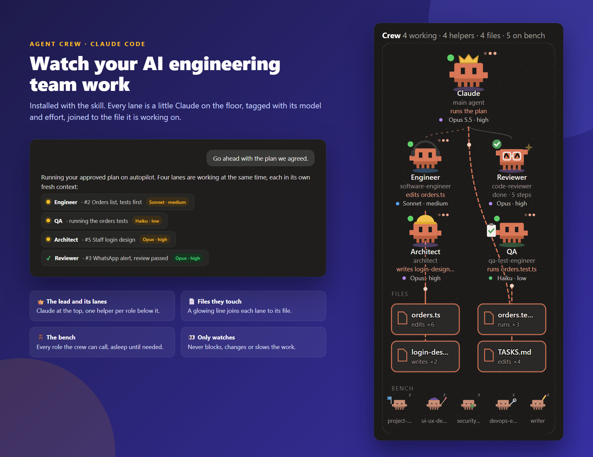

# Agent crew

A pane beside the chat in Claude Code that shows your AI engineering team at work. When the [Hire an Engineer](https://github.com/bilawalbaig8/hire-an-engineer) skill runs a plan, each lane (engineer, QA, reviewer, architect…) appears as a little Claude character on the floor.



## What you see

- **The lead and its lanes.** The main Claude stands at the top with a crown. Each helper (sub-agent) gets a smaller character below it, joined by a thin line.
- **Model and effort.** Under each character: its name, its agent type, what it does now (for example `edits orders.ts`) and the model and effort it runs on, such as `Sonnet · medium`.
- **Its state, acted out.** Working characters bob and type, with a green dot. Waiting ones look sleepy. Finished ones cheer with a green check, then walk back to the bench after 8 seconds. Failed ones slump with a red cross.
- **A prop for each role:** headphones for engineers, glasses for reviewers, a clipboard for QA, a hard hat for architects, a magnifier for Explore, and more.
- **Files they touch.** File cards sit on a shelf, and a glowing line joins each working agent to the file it is on.
- **The bench.** Every agent the session can call sleeps on the bench until Claude calls it. Hover one to read what it is for.

In the terminal there is no picture: the pane shows the same crew as plain text rows.

## Install

The crew installs by itself with the skill's plugin:

```text
/plugin install hire-an-engineer --marketplace bilawalbaig8/hire-an-engineer
```

To add only the crew:

```text
/plugin install agent-crew --marketplace bilawalbaig8/hire-an-engineer
```

## Use

The pane opens by itself when a session starts. Type `/crew` to open it again.

- `/crew bench` shows or hides the bench.
- `/crew bigger` and `/crew smaller` change how much of the pane's width the picture takes.
- `/crew clear` empties the floor, the file cards and the event list.

The mod only watches. It never blocks, changes or slows a tool call, a turn or a sub-agent.

## Credits

Made by Bilawal ([@bilawalbaig8](https://github.com/bilawalbaig8)). MIT license — keep the [LICENSE](../../LICENSE) when you share or adapt it.
