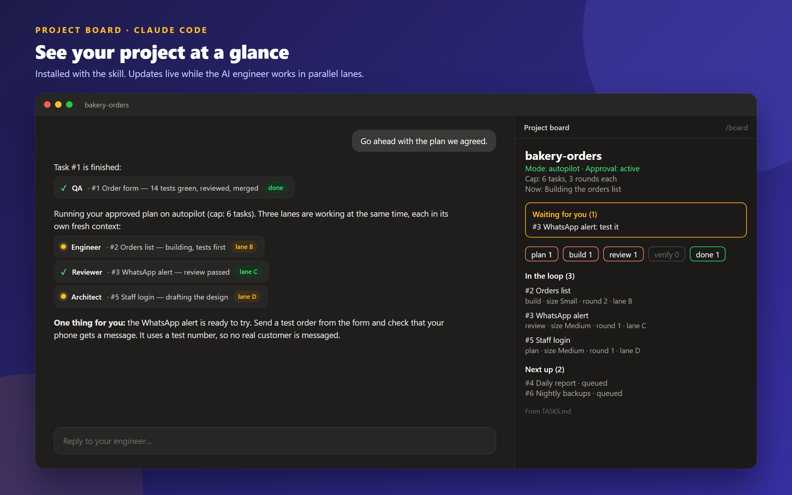

# Hire an Engineer board

A live board beside the chat in Claude Code for projects run by the [Hire an Engineer](https://github.com/bilawalbaig8/hire-an-engineer) skill. It reads the project's `TASKS.md` and `PROJECT_STATE.md` and shows, at a glance:

- **Waiting for you** — tasks that need your test, answer or OK
- **Tasks by stage** — plan, build, review, verify and done
- **In the loop** — what is being built now, its round and its lane
- **Approval** — autopilot or stepwise, whether the approval is active, and the agreed cap

It refreshes on its own every few seconds and right after the AI edits either file. It only reads; it never changes your files.



## Install

The board installs by itself with the skill's plugin:

```text
/plugin install hire-an-engineer --marketplace bilawalbaig8/hire-an-engineer
```

If you installed the skill from files, add just the board:

```text
/plugin install hire-an-engineer-board --marketplace bilawalbaig8/hire-an-engineer
```

Answer `y` to add the marketplace, then pick a scope. Open the board any time with `/board`; it also opens by itself when a session starts in a folder that has `TASKS.md` or `PROJECT_STATE.md`.

## Credits

Made by Bilawal ([@bilawalbaig8](https://github.com/bilawalbaig8)). MIT license — keep the [LICENSE](../../LICENSE) when you share or adapt it. If it helps you, a ⭐ on the [repository](https://github.com/bilawalbaig8/hire-an-engineer) is appreciated.
