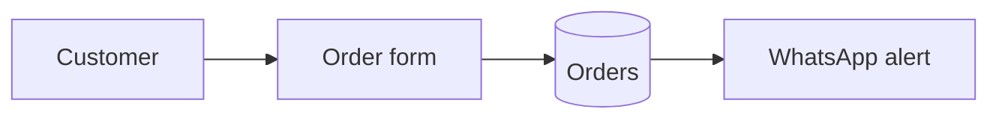

# Documents — format, visuals, skeletons

## Contents
1. Format and where documents live
2. Quality bar
3. Visuals per document
4. Mermaid quick reference
5. Skeletons

---

## 1. Format and where documents live

- **Source of truth:** Markdown + Mermaid in the repo's `docs/` (`project-memory.md`). Every AI tool can read it; it's versioned with the code.
- **Sharing:** when the person needs to send or present a document, export it in what they use (Word, PDF, Google Docs, Notion) or the environment's doc/artifact tool. Read the environment's document skill first if it has one. The Markdown stays master.
- **Size:** Tiny → a few lines in README. Small → one `docs/project.md`. Medium/Large → separate files indexed in `docs/README.md`.

## 2. Quality bar

- Title, date, version and a 2–3 line summary at the top.
- Person's language first; a marked technical section last ("Technical notes — aap ko parhne ki zaroorat nahi").
- Every diagram captioned in plain words; every table has headers.
- No placeholders ("TBD") — decide or ask.
- Updated in the same change as the code; bump version, note what changed.
- Readable by someone who wasn't in the conversation.

## 3. Visuals per document

| Document | Required | Optional |
|---|---|---|
| Brief | "Today vs with the tool" flow | Main-screen mockup |
| Tools & setup / integrations | Tools table with status | How tools connect |
| UX & UI | Journey flow, wireframes, mockup/screenshots, colour/type sample | 2 visual directions, states |
| System design | Architecture, main flow, ERD | Sequence (outside services), state diagram |
| Plan & roadmap | Gantt, milestone table | Progress/burndown chart |
| Test plan & report | Test table, pass/fail chart | Issues by severity |
| User guide | Screenshot/mockup per screen | Main task flow |
| Handoff | Architecture, "where everything lives" table | Troubleshooting flowchart |

Use Mermaid; where the format can't render it, render to an image. Charts from data: Mermaid `pie`/`xychart-beta`, or a chart image.

## 4. Mermaid quick reference

Other types to use: `sequenceDiagram` (outside services), `erDiagram` (data), `stateDiagram-v2` (statuses), `gantt` (timeline), `pie` (test results), `xychart-beta` (progress over time).

## 5. Skeletons

Expand only the sections the project needs.

**Brief** — Problem · Current workaround · Users (who, how many, device) · Core action · Must-haves v1 · Later · Not doing · Constraints · Done when · Words the person uses (for naming)

**System design** — Approach + one rejected alternative · Components table (part / job / built with) · Diagrams · Data model (→ data dictionary) · Key flows · Integrations · Risks & safeguards · Decisions (links to `docs/decisions/`)

**UX & UI** — Users & journeys · Screen inventory · Wireframes · Visual plan (colours, type, layout) · States per screen · Copy decisions · Accessibility notes · Mockup link

**Plan & roadmap** — Status line (🟢/🟡/🔴) · Roadmap (versions) · Milestones table (delivers / date / needed from owner / status) · Gantt · Risk register (risk / likelihood / impact / action) · Board link · Change log

**Test plan** — per milestone: ID · scenario · Given · When · Then · type (normal/edge/failure/security). **Test report:** summary (x/y passed), chart, results table, open issues with severity.

**Release checklist** — checks green on test (evidence) · no open P0/P1 · secrets in hosting · backup + restore tried · rollback ready · version/changelog/tag · owner approved · deployed · checks re-run on live · monitoring on

**User guide** — What it does · How to open · One section per task (screenshot + steps) · Common questions · If something goes wrong

**Handoff & maintenance** — Run it · Change common things · Backups & restore · Monitoring & alerts · When it breaks · Integrations & keys (names/locations only) · Costs to watch · Known limits · Next ideas · Technical section (setup from zero, architecture, decisions, tests, design spec)
