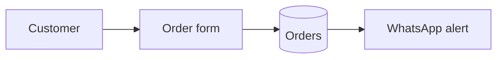

# Documents — format, visuals, skeletons

## 1. Format and where documents live

- **Source of truth:** Markdown + Mermaid in the repo's `docs/`. Every AI tool can read it; it's versioned with the code.
- **Sharing:** when the person needs to send or present a document, export it in what they use (Word, PDF, Google Docs, Notion) or the environment's doc/artifact tool. Read the environment's document skill first if it has one. The Markdown stays master.
- **Size:** minimum files per size: `project-memory.md` §1. Small → one `docs/project.md`. Medium/Large → separate files indexed in `docs/README.md`.

## 2. Quality bar and the two layers

- **Two layers:** the person's language first, plain words; a marked technical section last, for a future developer or agent ("Technical notes", in their language).

- Title, date, version and a 2–3 line summary at the top.
- Every diagram captioned in plain words; every table has headers.
- No placeholders ("TBD") — decide or ask.
- Facts from outside (prices, limits, market numbers, research) carry their source and date beside them; your own estimates and assumptions are labelled as such.
- Updated in the same change as the code; bump version, note what changed.
- Readable by someone who wasn't in the conversation.

## 3. Visuals per document

| Document | Required | Optional |
|---|---|---|
| Brief | "Today vs with the tool" flow | Main-screen mockup |
| Tools & setup / integrations | Tools table with status | How tools connect |
| UX & UI | Journey flow, wireframes, mockup/screenshots, colour/type sample | 2 visual directions, states |
| System design | Architecture, main flow, ERD | Sequence (outside services), state diagram |
| Plan & roadmap | Milestone table (Gantt: Medium+) | Progress chart (Medium+) |
| Test plan & report | Test table, pass/fail chart | Issues by severity |
| User guide | Screenshot/mockup per screen | Main task flow |
| Handoff | Architecture, "where everything lives" table | Troubleshooting flowchart |

Use Mermaid; where the format can't render it, render to an image. Charts from data: Mermaid `pie`/`xychart-beta`, or a chart image.

Every diagram follows the quality rules in §7. Mermaid in `docs/` is the editable source every AI tool can change. When the person will **see, present or share** a diagram (a deck, a PDF, a review, a handoff), and the environment has a dedicated diagram skill (e.g. `diagram-design`), redraw it with that skill from the same content and link the polished file next to the Mermaid source; otherwise apply §7 to the Mermaid itself.

## 4. Mermaid quick reference


Other types to use: `sequenceDiagram` (outside services), `erDiagram` (data), `stateDiagram-v2` (statuses), `gantt` (timeline), `pie` (test results), `xychart-beta` (progress over time).

## 5. Skeletons

Expand only the sections the project needs.

**Brief** — Problem · Current workaround · Users (who, how many, device) · Core action · Must-haves v1 · Later · Not doing · Constraints · Done when · Words the person uses (for naming)

**System design** — Approach + one rejected alternative · Components table (part / job / built with) · Diagrams · Data model (→ data dictionary) · Key flows · Integrations · Risks & safeguards · Decisions (links to `docs/decisions/`)

**UX & UI** — Users & journeys · Screen inventory · Wireframes · Visual plan (colours, type, layout) · States per screen · Copy decisions · Accessibility notes · Mockup link

**Plan & roadmap** — Status line (format: `project-management.md` §6) · Roadmap (versions) · Milestones table (delivers / date / needed from owner / status) · Gantt · Risk register (risk / likelihood / impact / action) · Board link · Change log

**Test plan** — per milestone: ID · scenario · Given · When · Then · type (normal/edge/failure/security). **Test report:** summary (x/y passed), chart, results table, open issues with severity.

**Release checklist** — see `versioning-release.md`.

**User guide** — What it does · How to open · One section per task (screenshot + steps) · Common questions · If something goes wrong

**Handoff & maintenance** — Run it · Change common things · Backups & restore · Monitoring & alerts · When it breaks · Integrations & keys (names/locations only) · Costs to watch · Known limits · Next ideas · Technical section (setup from zero, architecture, decisions, tests, design spec)

**Your project at a glance** (`docs/at-a-glance.md`; Small+, from the first milestone; plain words, update each milestone) — Where it lives (links) · Accounts they own · Monthly cost · How to run and recover it if this AI tool disappears

## 6. Scaffold tree and docs-as-code

Full tree for Medium/Large (adapt names to the stack; grow into it, no empty folders):

```
project/
├── AGENTS.md            ← rules for ANY AI agent (tool-agnostic)
├── CLAUDE.md            ← one line: "Read AGENTS.md"
├── PROJECT_STATE.md     ← where we are now; read first, update last
├── README.md  CHANGELOG.md  .gitignore  .env.example
├── docs/
│   ├── README.md        ← index of all docs
│   ├── at-a-glance.md  brief.md  history.md
│   ├── design/          ← system-design.md, ux-ui.md, data-dictionary.md, diagrams
│   ├── decisions/       ← 0001-use-supabase.md … (one per decision)
│   ├── plans/           ← roadmap.md, milestone and implementation plans
│   ├── tests/           ← test-plan.md, reports/
│   ├── ops/             ← tools-setup.md, integrations.md, costs.md, release-checklist.md, runbook.md
│   └── guides/          ← user-guide.md, handoff.md
├── src/  tests/
└── scripts/             ← one-off and maintenance scripts, each with a comment header
```

Docs-as-code:
- Docs live in `docs/` as Markdown + Mermaid, versioned with the code, reviewed in the same PR as the change.
- Definition of Done includes docs: a change to behaviour, data, setup or decisions isn't done until the doc is updated.
- `docs/README.md` indexes every document, one line each.
- Export or publish (PDF, Word, Google Docs) when they need to share; the Markdown stays the source.

## 7. Diagram quality

Rules for every diagram, whatever the tool. The best move is usually removing something.

**Draw only when it beats words.** Ask: would the reader learn more from this than from a good paragraph or a table? A list of things → table or bullets. A one-box "diagram" → a sentence. Before/after of settings → a table.

**Pick the type by what you're showing:**

| Showing | Type |
|---|---|
| Parts of the system and how they connect | Architecture |
| Decisions with yes/no branches | Flowchart |
| Messages over time between the app, people and outside services | Sequence |
| Statuses an item moves through (order: new → paid → sent) | State diagram |
| What data is stored and how it links | ER / data model |
| Who does which step, with handoffs between people or teams | Swimlane |
| What a user does and feels at each step | User journey |
| Dates, milestones, phases | Timeline or Gantt |
| Ranking options on two axes (impact vs effort) | Quadrant |
| Drop-off between steps (visits → sign-ups → buyers) | Funnel |
| Parent → children (categories, folders, org) | Tree |
| What depends on what | Dependency graph |
| Causes of one problem | Fishbone |

If two types seem to fit, pick the one for the main point; never mix two layouts in one diagram.

**Keep it small:**
- At most ~9 boxes and ~12 arrows. More than that → split into an overview plus a detail diagram.
- Two boxes that always go together are one box. An arrow the layout already makes obvious is removed. A label that colour or shape already says is removed.
- Done when nothing more can be removed, not when everything is in.

**Make the point visible:**
- Highlight 1–2 elements only (the main path, the new part, the risk). Highlighting five erases the signal.
- Same kind of thing, same look: people/users, the app's own parts, stored data, outside services, optional/async steps each get one consistent style, explained in a legend strip at the bottom — never a legend floating inside the drawing.
- Box names in plain words the person uses ("Order form", not `OrderFormComponent`); technical detail (ports, URLs, table names) only as small secondary text, and only in the technical layer.

**Clean lines:**
- Right-angle connectors, no diagonal tangles; lines never run on top of each other or behind a box they don't connect to.
- Each arrow leaving the same side of a box gets its own attach point.
- Arrow labels short (1–3 words), sitting beside the line with a gap, never crossing it. No sideways text.
- Solid arrows for the main flow, dashed for optional, async or replies.

**Look calm, not "AI-generated":** no shadows, glows, neon-on-dark or heavy gradients; small corner radius; vary box sizes to show what matters instead of identical boxes everywhere. Use the project's colours and fonts from the visual plan (`visual-quality.md`), so diagrams match the product.

**Readable everywhere:** a plain-words caption under every diagram (§2); readable on a phone (the diagram scrolls inside its own box, the page doesn't); an accessible title and description on SVG/HTML diagrams; a light and a dark version only if the person presents in both.

**Before drawing,** decide in one line: type, size (doc, slide 16:9, social), and what the size limit forces out. Say it to the person only for diagrams they'll present.

**Redrawing an existing diagram** (draw.io, Mermaid, Excalidraw, a photo of a whiteboard): keep the content (parts, links, grouping, direction), redraw the layout fresh, never invent a part, and tell the person what you merged or dropped.

**Check before showing:** type fits; removal test done (box, arrow, label); ≤2 highlights; legend covers every style used and nothing extra; no overlapping lines or labels; caption written; looked at the rendered result yourself (screenshot or open it), not just the code.

