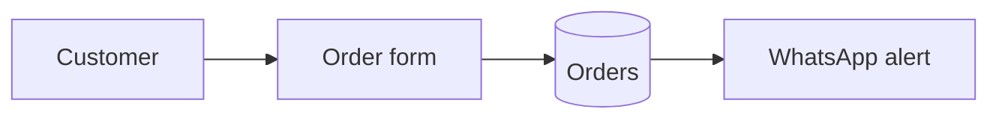

# Documents — format, visuals, skeletons

## 1. Format and where documents live

- **Source of truth:** Markdown + Mermaid in the repo's `docs/`. Every AI tool can read it; it's versioned with the code.
- **Sharing:** when the person needs to send or present a document, export it in what they use (Word, PDF, Google Docs, Notion) or the environment's doc/artifact tool. Read the environment's document skill first if it has one. The Markdown stays master.
- **Size:** minimum files per size: `project-memory.md` §1 (Tiny = README + PROJECT_STATE.md). Small → one `docs/project.md`. Medium/Large → separate files indexed in `docs/README.md`.

## 2. Quality bar and the two layers

- **Two layers:** the person's language first, plain words; a marked technical section last, for a future developer or agent ("Technical notes", in their language).

- Title, date, version and a 2–3 line summary at the top.
- Every diagram captioned in plain words; every table has headers.
- No placeholders ("TBD") — decide or ask.
- Updated in the same change as the code; bump version, note what changed.
- Readable by someone who wasn't in the conversation.

## 3. Visuals per document

| Document | Required | Optional |
|---|---|---|
| Brief | "Today vs with the tool" flow | Main-screen mockup |
| Tools & setup / integrations | Tools table with status | How tools connect |
| UX & UI | Journey flow, wireframes, mockup/screenshots, colour/type sample | 2 visual directions, states |
| System design | Architecture, main flow, ERD | Sequence (outside services), state diagram |
| Plan & roadmap | Milestone table (Gantt: Medium+) | Progress chart (Medium+) |
| Test plan & report | Test table, pass/fail chart | Issues by severity |
| User guide | Screenshot/mockup per screen | Main task flow |
| Handoff | Architecture, "where everything lives" table | Troubleshooting flowchart |

Use Mermaid; where the format can't render it, render to an image. Charts from data: Mermaid `pie`/`xychart-beta`, or a chart image.

## 4. Mermaid quick reference


Other types to use: `sequenceDiagram` (outside services), `erDiagram` (data), `stateDiagram-v2` (statuses), `gantt` (timeline), `pie` (test results), `xychart-beta` (progress over time).

## 5. Skeletons

Expand only the sections the project needs.

**Brief** — Problem · Current workaround · Users (who, how many, device) · Core action · Must-haves v1 · Later · Not doing · Constraints · Done when · Words the person uses (for naming)

**System design** — Approach + one rejected alternative · Components table (part / job / built with) · Diagrams · Data model (→ data dictionary) · Key flows · Integrations · Risks & safeguards · Decisions (links to `docs/decisions/`)

**UX & UI** — Users & journeys · Screen inventory · Wireframes · Visual plan (colours, type, layout) · States per screen · Copy decisions · Accessibility notes · Mockup link

**Plan & roadmap** — Status line (format: `project-management.md` §6) · Roadmap (versions) · Milestones table (delivers / date / needed from owner / status) · Gantt · Risk register (risk / likelihood / impact / action) · Board link · Change log

**Test plan** — per milestone: ID · scenario · Given · When · Then · type (normal/edge/failure/security). **Test report:** summary (x/y passed), chart, results table, open issues with severity.

**Release checklist** — see `versioning-release.md`.

**User guide** — What it does · How to open · One section per task (screenshot + steps) · Common questions · If something goes wrong

**Handoff & maintenance** — Run it · Change common things · Backups & restore · Monitoring & alerts · When it breaks · Integrations & keys (names/locations only) · Costs to watch · Known limits · Next ideas · Technical section (setup from zero, architecture, decisions, tests, design spec)

**Your project at a glance** (`docs/at-a-glance.md`; Small+, from the first milestone; plain words, update each milestone) — Where it lives (links) · Accounts they own · Monthly cost · How to run and recover it if this AI tool disappears

## 6. Scaffold tree and docs-as-code

Full tree for Medium/Large (adapt names to the stack; grow into it, no empty folders):

```
project/
├── AGENTS.md            ← rules for ANY AI agent (tool-agnostic)
├── CLAUDE.md            ← one line: "Read AGENTS.md"
├── PROJECT_STATE.md     ← where we are now; read first, update last
├── README.md  CHANGELOG.md  .gitignore  .env.example
├── docs/
│   ├── README.md        ← index of all docs
│   ├── at-a-glance.md  brief.md  history.md
│   ├── design/          ← system-design.md, ux-ui.md, data-dictionary.md, diagrams
│   ├── decisions/       ← 0001-use-supabase.md … (one per decision)
│   ├── plans/           ← roadmap.md, milestone and implementation plans
│   ├── tests/           ← test-plan.md, reports/
│   ├── ops/             ← tools-setup.md, integrations.md, costs.md, release-checklist.md, runbook.md
│   └── guides/          ← user-guide.md, handoff.md
├── src/  tests/
└── scripts/             ← one-off and maintenance scripts, each with a comment header
```

Docs-as-code:
- Docs live in `docs/` as Markdown + Mermaid, versioned with the code, reviewed in the same PR as the change.
- Definition of Done includes docs: a change to behaviour, data, setup or decisions isn't done until the doc is updated.
- `docs/README.md` indexes every document, one line each.
- Export or publish (PDF, Word, Google Docs) when they need to share; the Markdown stays the source.
