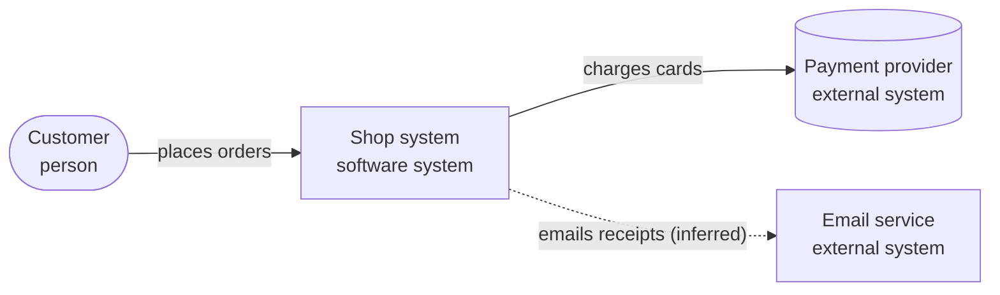
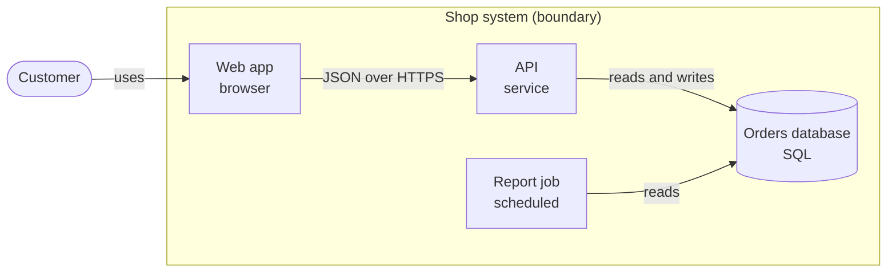
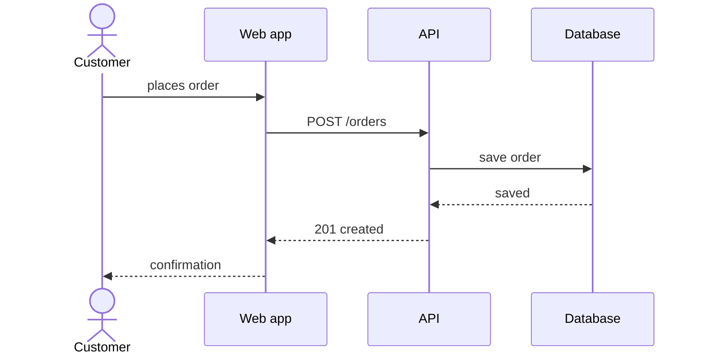
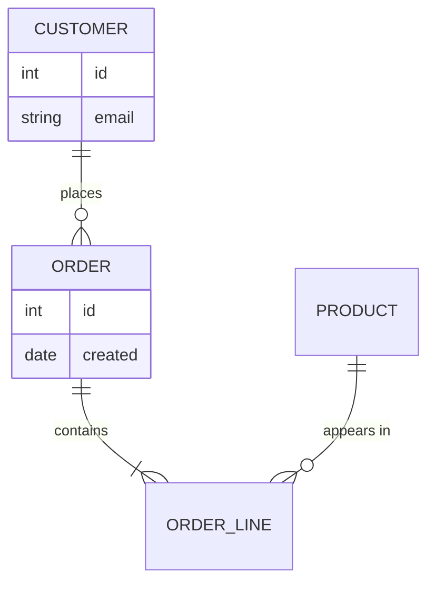
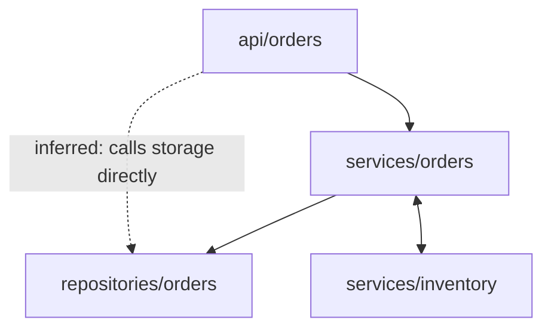
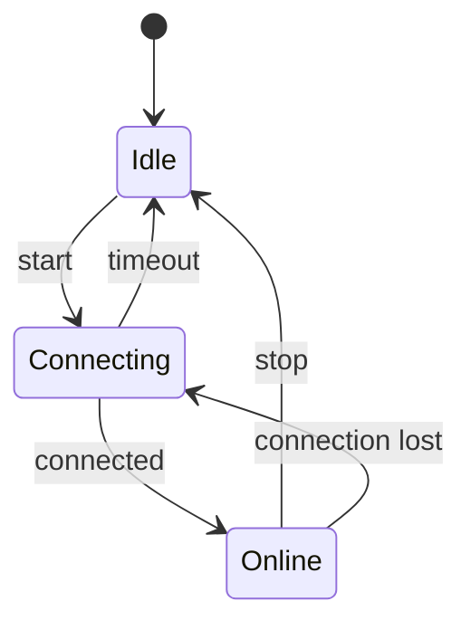

# Architecture diagrams

When to read this: you are about to draw, update or review any architecture diagram, or choose a diagram tool. These rules extend the general diagram guidance of the `hire-an-engineer` skill (draw only when it beats words; keep it readable on a phone) with architecture-specific rules.

## 1. Pick the diagram by the question

One diagram answers one question at one level of detail.

| Question | Diagram | Level |
|---|---|---|
| Who and what does the system talk to? | System context | C4 level 1 |
| What are the deployable or runnable parts and how do they connect? | Container view | C4 level 2 |
| What is inside one container? | Component view | C4 level 3 (only for the part that needs it) |
| What happens, step by step, for one use case? | Sequence diagram | runtime |
| What is stored and how are the pieces related? | Entity-relationship diagram | data |
| Who imports whom (existing code)? | Dependency graph | static structure |
| How does a long-lived thing change over time? | State diagram | behaviour |
| Where does each part run? | Deployment view | infrastructure |

The C4 model uses four zoom levels (context, container, component, code); draw the top two for almost every project and the third only where it earns its place. [S-FND-11]

## 2. Tools and defaults

- **Default: Mermaid text** stored in the project as a `.mmd` file or a fenced `mermaid` block in a Markdown file. Many places render it directly (GitHub, many editors, documentation sites), it diffs well, and an agent can write it. [S-DIA-1]
- **Model-first tools** (one model, many views) when the project needs them: LikeC4 (command-line validate and export, plus an agent-facing server) or Structurizr DSL. [S-DIA-5] [S-DIA-2] Pick one per project and keep the model file in the repository.
- **Fallbacks:** D2 when layout quality matters [S-DIA-4]; PlantUML for heavy UML or an existing PlantUML estate [S-DIA-3]; Excalidraw for hand sketches only. [S-DIA-7]
- **Commands** (not run here: confirm them before relying on them): Mermaid CLI `npx -p @mermaid-js/mermaid-cli mmdc -i in.mmd -o out.svg` needs a headless browser download; PlantUML `java -jar plantuml.jar --svg diagram.puml`; D2 `d2 in.d2 out.svg`. The Structurizr command line changed recently, so check its current documentation. **Ask the boss to ask the owner before installing any tool.**

## 3. Readability rules

1. One question and one level per diagram. Never mix a system overview with code-level detail.
2. At most about 9 boxes per diagram. If you need more, split the diagram or group boxes.
3. Every box has a name, a short type (person, service, database, queue, screen) and, where useful, the technology.
4. Every arrow has a short verb label and a clear direction; add the protocol or data kind when it matters. No unlabelled arrows.
5. Show the system boundary and external systems explicitly.
6. A legend or key explains shapes, colours and line styles. Colour and shape must mean something and be used consistently.
7. Draw links you only inferred as dashed lines, and say so in the legend. Verified links are solid. [S-DIA-8]
8. Highlight at most one or two things that matter for the question (the risk, the new part).
9. Add a one-line caption saying what the picture shows and for whom.
10. It must read on a phone-sized screen: short labels, few boxes, no tiny text.
11. Avoid: everything connected to everything, mixed abstraction levels, decorative icons that carry no meaning, crossing lines you could avoid.

Review checklist (each item yes or no): title and scope; one question; at most 9 elements; every element named and typed; every arrow labelled with direction; legend; boundaries and external systems shown; inferred links dashed; caption. [S-DIA-8]

## 4. Templates (Mermaid)

The six templates were rendered and looked at in a browser with Mermaid 10.9.1 on 2026-10-22 (the command-line renderer was not installed). Replace the names; keep the conventions. A solid arrow is a verified or designed link; a dashed arrow is inferred.

System context:

Container view:

Sequence (one use case):

Entity-relationship:

Dependency graph (existing code; verified edges solid, inferred dashed, a cycle marked):

State diagram:

## 5. Draw, render, look, fix

1. Write the diagram source into the project, for example `docs/architecture/diagrams/context.mmd`.
2. Check it renders. If a renderer is available (or the editor or viewer renders Mermaid), render it and **look at the result**: no overlaps, readable labels, correct arrows, within the element limit. Fix and render again.
3. If you cannot render, give the source and say plainly: "Diagram source written; not rendered here, so I could not check how it looks." Never claim you checked a picture you did not see.
4. In your answer include the simple picture for the owner (a small diagram, or a short list "A talks to B, B stores in C"), and the file path of the full source.
5. Keep the source and the rendered image in the same folder; re-render when the source changes.

## 6. Redraw rules

- When the architecture changes, change the diagram in the same change; a stale diagram is worse than none.
- If a diagram grows past the limit, split it by question or by container.
- Do not keep two diagrams that disagree; delete or fix one.

## Sources
[S-FND-11] [S-DIA-1] [S-DIA-2] [S-DIA-3] [S-DIA-4] [S-DIA-5] [S-DIA-7] [S-DIA-8]
